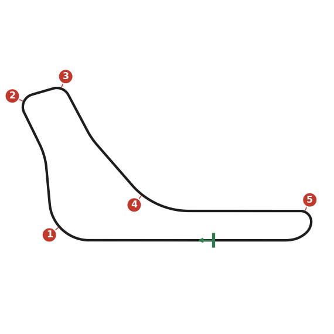
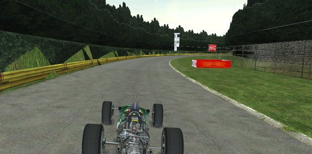
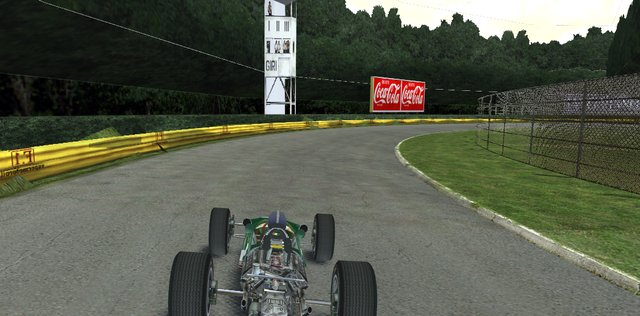
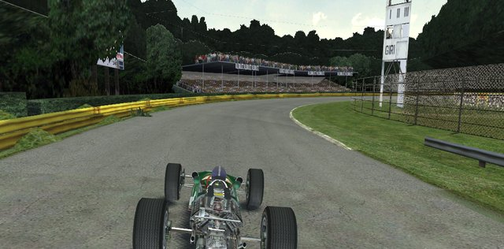
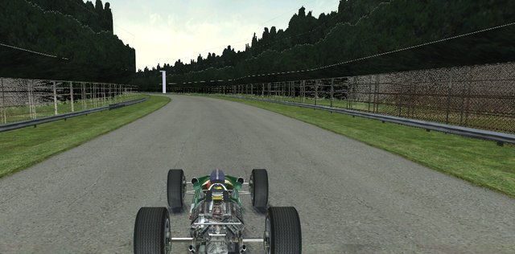
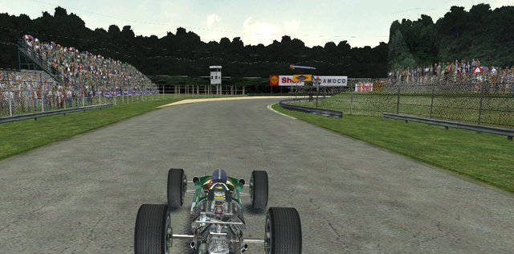

# Monza

Three real corners joined by very long straights. The lap is about top speed: how soon you reach it and how long you
keep it. The tow makes passing easy, so you can push the whole race.

## Setup

- **Ascari decides the springs.** If you can't take it flat, stiffen the car.
- **Balance:** neutral, then a touch of understeer. You trail-brake into the slow corners, which cancels it out, and the
  throttle steers the car through the fast ones.
- **Gears:** set top gear on the straight into Parabolica, so you reach the limit just before braking. Space the others
  so you leave the second Lesmo in second and reach fourth before the bridge.
- **Diff:** lock the rears tightly together (plenty of plates, steep ramps). You get on the power sooner and can brake
  later.
- **Start:** the first corner is the most dangerous point of the race, with everyone arriving two or three abreast on
  cold tyres. Take it easy there.

## Corners

### 1. Curva Grande

A long, fast right-hander at the end of the start straight. Don't use much brake, and don't leave the apex too soon.

- **Brake:** as you reach the service road before the turn, brake moderately for a moment and change down once. Then let
  the engine do the rest.
- **Turn-in:** at the same moment as you brake. Early apex, against the kerb, and stay there past the lone tree on the
  right.
- **Through:** a trailing throttle at first, with enough power to keep the rear in line, then more power to slide the car
  round.
- **Exit:** full throttle from the tree. Let the four-wheel drift carry you toward the grass on the left; if you get
  there too soon, lift a little.

### 2. First Lesmo

A right-hander after the flat-out Della Roggia kink. The braking zone is long enough to pass in.

- **Entry:** from the left. Where the dark line begins, wait a second, then brake as hard as you can without locking.
  Change down to second steadily; quick downshifts lock the rears.
- **Turn-in:** just before the barrier on the left, trail-braking. Long apex, reached early.
- **Through:** balance the car on the throttle and change up to third mid-corner, while you're not yet accelerating.
- **Exit:** full throttle just past half way; slide out left and get straight against the left side.

### 3. Second Lesmo

A right-hander that opens the long flat-out run to Parabolica, so the exit is what matters. There's no braking zone,
so don't try to pass here.

- **Brake:** where the dark line lightens again at the entry, brake briefly and change down to second.
- **Line:** turn in straight away; late apex, about half way round. Change up to third just before the apex, on a
  neutral throttle.
- **Keep it tidy:** a slide here costs more than a lift. The grass on the left is very slippery.
- **Exit:** feed the power in from the apex, drift left in as straight a line as you can, full throttle before the
  edge.

### 4. Ascari

A fast left-hander, flat out when it's done right. That depends on the entry: turn in too early and you run onto the
grass, too late and you understeer into the barrier.

- **Entry:** in top gear, from the middle of the road. Turn in just before the barrier on the right, with as little lock
  as you can.
- **Through:** keep tight against the grass on the left, where the camber helps the car turn. Throttle flat all the way.
- **Exit:** once you can see the straight, unwind slowly and drift right. The service road on the right is there if
  you need it.

### 5. Parabolica

A long right-hander that tightens at the start and opens out. It ends the fastest straight and starts the start
straight, which makes it the best place to pass and the most important exit.

- **Brake:** against the left side of the road, in a straight line, as hard as you can just after the back of the
  billboard on the left. Change down to second without locking.
- **Turn-in:** at the kerb, still braking lightly. Hold the car on the kerb; if it pushes away, ease off.
- **Through:** where the kerb ends (half way), add power. Change up to third when the rear starts to step out; then
  full throttle.
- **Exit:** unwind slowly and let the car drift all the way to the left, just missing the barrier.
