# Nürburgring

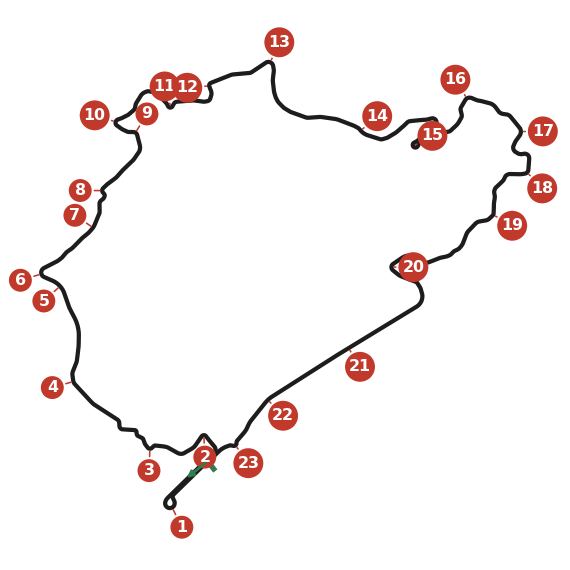

22.8 km and around 170 corners, with crests, jumps and compressions. Learn the line before anything else: that's
where the time is. Relax; you can't keep the car together for a whole lap while tense. Set yourself steps (a clean lap,
then 11 minutes, 10, 9:30...) rather than chasing a fast lap at once. With a full fuel load, several corners that
are flat in qualifying are not, and the car bottoms out in more places.

## Setup

- **Learn the track first.** The default setup is good enough until you lap consistently.
- **Ride height:** medium, rear a little higher than the front. Too low and it bottoms everywhere; too high and it goes
  loose over the crests.
- **Gears:** a tall top gear for the long straight (reach the rev limit just before the bridge). Space the rest for 100
  to 220 km/h acceleration; a big gap from fourth to top is fine.
- **Suspension:** neutral. Anti-roll bars about equal, a little more spring at the rear. Favour staying on the road when
  the suspension is at its limit over all-out grip.
- **Brake bias** fairly far forward; most braking happens while turning.
- **The race:** finishing scores well. There are three real passing places: Südkehre, Nordkehre and the long straight.
  Take it easy through the first corners from the start; the first is a slow left after a wide straight.

## 1. Südkehre

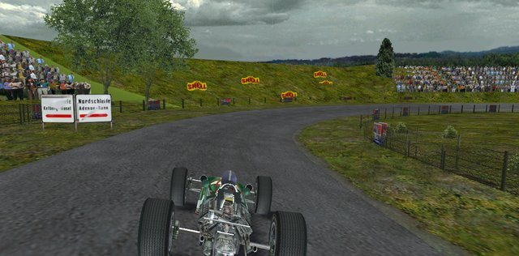

- **Left hairpin:** one of the few hard stops, with no marker. Move right after the pits. Brake halfway between the two
  dark patches of rubber (the second is where the grass meets the fence on the left). Brake straight, change down to
  second, and turn in only when almost there. Ease the brakes to turn; late apex at the grass.
- **Long right:** change down to first without braking and hold about 100 km/h on a steady throttle. If you run wide,
  add power. Change up at the red signs on the left and run out to the left edge.

## 2. Nordkehre

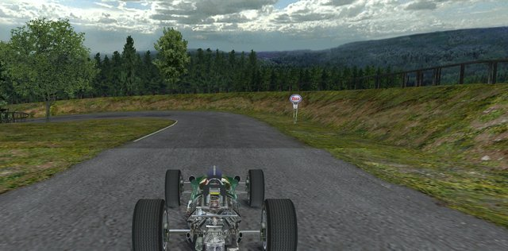

- **Left at the end of the straight behind the pits:** the second passing place. On the right, close to the garage
  wall. Brake hard at the second yellow banner after the dark line starts, straight and parallel to the wall, down to
  second. Early apex; the camber and slight climb carry you round. Don't over-power the exit.
- **Left over a crest:** line up straight along the outside edge *before* the access road; you can't see the edge
  until it's too late. Brake briefly at the crest, ease off as the rear goes light, brake again. Trail-brake right to
  the apex, just before the middle.
- **Downhill right:** turn in earlier than you expect. A short brake after the lone bush on the left, then let a small
  four-wheel drift carry you to the apex.

## 3. Hatzenbach

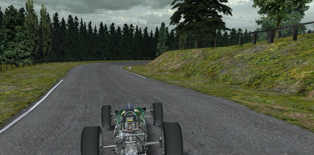

Eight corners through the woods, mostly second gear. A smooth line matters more than power, because each exit sets
up the next.

- **Left (fast):** a small lift, early apex; exit straight and close to the right edge.
- **Left (downhill):** brake a third to half way down the straight, down to second. Don't overshoot onto the high bank.
- **The tight rights and lefts that follow:** a tap of the brake as the dark line starts, a steady throttle, and the
  grass as a kerb. Large arcs, middle apexes, exit toward the middle of the road. Getting the line right comes before
  the power.
- **Last left (downhill):** no brakes; turn in as the road drops and leave the apex late. It opens onto a straight.

## 4. Flugplatz

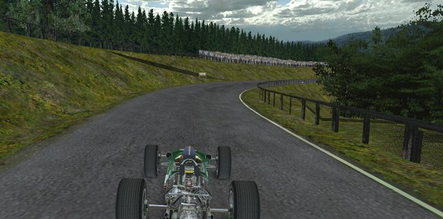

- **The bridge bump:** lift briefly, or you over-rev and land out of shape.
- **The jump:** in fourth, up the hill toward the left edge. Not sure of your line? Stay in the middle. Ease off a
  little at take-off but keep some power: off the power, the nose drops first. Land with the wheel straight; a little
  more or less throttle in the air corrects a roll.
- **Right after the landing:** a moderate brake as the dark line starts, then a long power slide started by
  trail-braking.
- **Long downhill left:** change up and keep it flat.

## 5. Schwedenkreuz

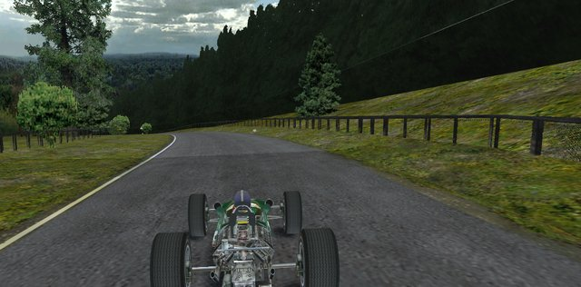

- **The right kink before it:** flat over the small crest, late apex, crossing to the right.
- **Left:** brake very hard for a moment where the dark line starts, down one gear, and turn in as the road climbs.
  Late apex: the usual mistake is braking too late and missing the following right. Off the brakes by the tree on the
  right; exit on the left.

## 6. Aremberg

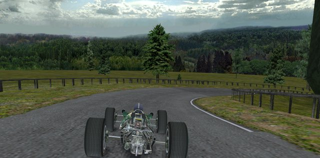

- **Downhill right:** from the left. Brake hard just before the tree by the fence on the left, down to second, straight
  until the sign; then trail-brake to an apex before the middle, and hold it. Exit to the left before the bridge.
- **Downhill esses:** flat, like skiing: apex on the grass, aim for the next. Change up just as you turn into an ess.

## 7. Fuchsröhre

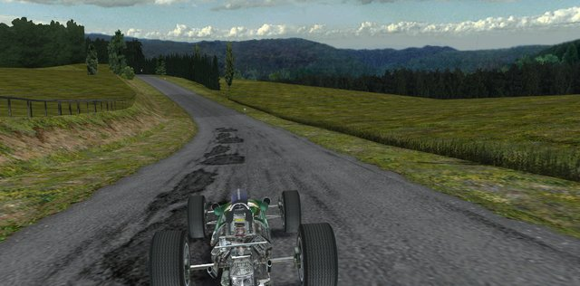

- **Left at the bottom (compression):** the car wants to bottom out. Don't be on the left as the road climbs: let it run
  wide right and keep some power on, which plants the rear and lifts the nose. Half throttle (maybe a tap of brake) as
  the dark line starts; think of it as one long corner with the apex at the second bend. With full tanks, brake earlier
  and harder.
- **Left up the hill:** the car is at its limit, so brake moderately halfway up and change down two gears. Turn in at
  the tree on the right; late apex, power on to keep the rear in line. Exit as far left as you can.

## 8. Adenauer Forst

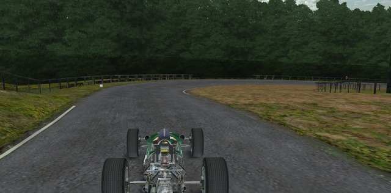

- **Right:** get the car straight before you brake, or it spins. Brake moderately at the tree on the right, down to
  second; turn in after the white line. The rear is light and the car turns fast. Late apex.
- **Double left:** use the first bend to slow down (brake gently, down to first), drift no further than mid-road. Then
  middle apex at the grass; lift at the apex to help the front.
- **Right:** hold the apex on the throttle, change up just before the end; run out to the left edge. The section that
  follows is fast but hard to pass in.

## 9. Metzgesfeld

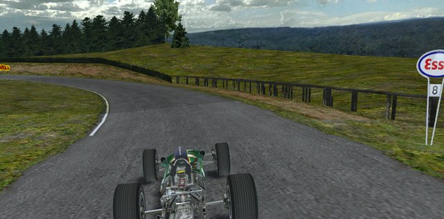

- **Double left:** from the right. Brake moderately at the shed on the left, down one gear; stay off the inside of the
  first bend and draw one arc into the second. Brake again midway, down another gear, middle apex.
- **Left:** wait a beat after the dark line, brake hard, down to second. Trail-brake to a late apex: the bank at the
  exit is steep and unforgiving.
- **Right:** early apex; the rear goes light where the road flattens. Settle it before Kallenhard.

## 10. Kallenhard

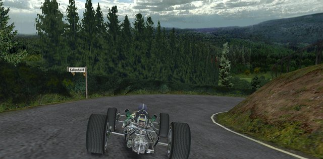

- **Downhill right:** easy to brake too late. From the left, straight down the hill; moderate brake, down to second;
  turn in at the white line and trail-brake to rotate the car. Early apex, steady throttle.
- **Left-right:** brake moderately before the dark line, then let the rear slide until you're pointing at the bushes
  inside. Brush past them, full power over the bump, then across to the white line by the hill.
- **Four rights:** the first is the tightest. Brake gently as the dark line starts, then a trailing throttle; no more
  brake after the first bend. Full power through the last.

## 11. Wehrseifen

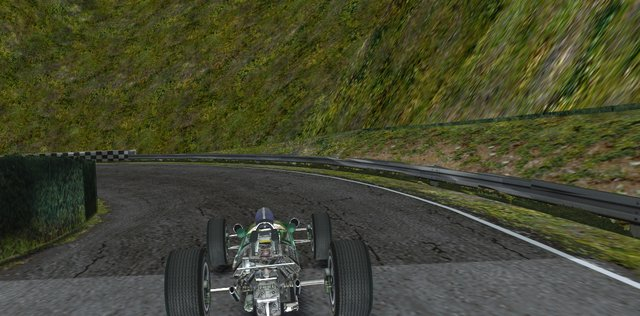

- **Left at the bridge:** wait a moment after the dark patch, brake fairly hard, down to second before the small right
  bend (ease the brakes over it), then down to first. Turn in at the barrier; left front close to the bridge wall.
- **Right:** no brakes; a straight line across the road meets the apex. The rear is light at the exit.
- **Left over the bridge:** brake hard after the white line ends, down to third; tighten in as the corner does, down to
  second. Be off the brakes before the hump on the bridge, or the rear goes.

## 12. Ex-Mühle

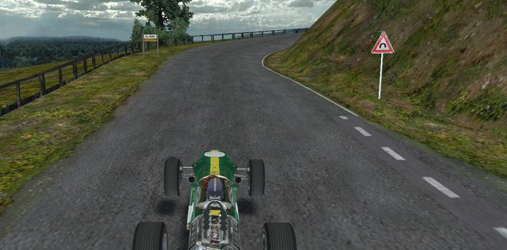

- **Uphill right:** the steepest climb on the lap; let it slow you. Brake moderately where the dark line pauses, and
  turn in only at the corner. Change down to first at the inside; change up just after the crest.
- **Left:** a bump just before the apex. Ease off before the crest, a little power over it, then a moderate brake. Turn
  in just before the bump, late apex, power on all the way out to the middle.

## 13. Bergwerk

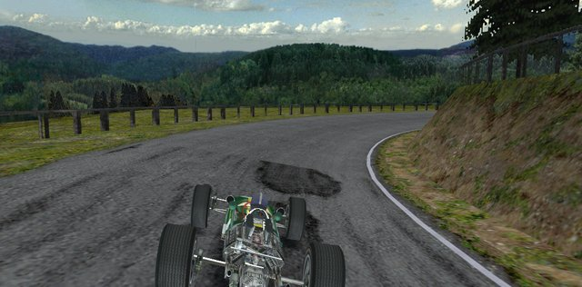

- **Right:** all about trail-braking. Brake as hard as you can a few car lengths before the dark line, down to second;
  turn in where it lightens and release the brakes slowly to the apex (mid-corner). Release too fast and you
  understeer off.
- **Long left (several bends):** change up on the bump in the first bend. The third and fourth bends decide it: left
  front touching the grass at both apexes, and it's flat (in qualifying). Too wide: lift. Lift over the crest at the
  end.
- **Fast left:** from the very right edge, turn in just after the dark line; about 90 % throttle to the apex, then full
  power to the edge.

## 14. Kesselchen

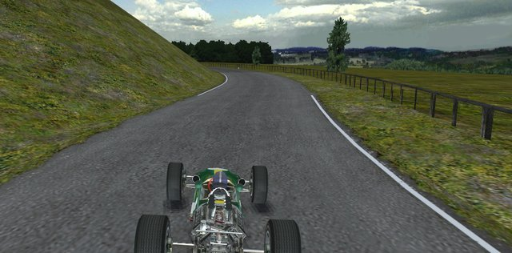

- **Right-left:** in top gear. A moderate brake at the tree on the right, down one gear; hardly any steering. About half
  throttle over the big bump at the right apex, then the left apex, then full power.
- **Fast left:** turn in early: brake fairly hard and change down where the dark line lightens. Mid apex, steady
  throttle; stay straight over the dip.
- **Uphill right:** blind, with adverse camber at the top. Moderate brake, release before turning in, late apex. Brake
  too hard and the left front locks.
- **Right:** brake just before the left bend, ease off, brake again at the crest; trail-brake in near the end of the
  fence.

## 15. Karussell

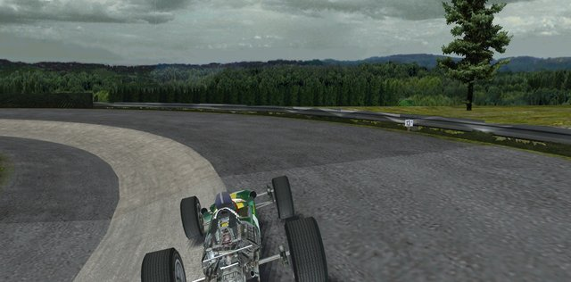

- **The Karussell:** aim at the tall tree straight ahead, change up, clip the bushes left then right. Brake as hard as
  you can at the right-hand bushes, down to first. Release before the banking (it drops away; braking locks the
  fronts). Hold a steady 80 km/h on the narrow banking; if you leave it, leave it downward.
- **Fast left:** a brush of the brakes; middle apex, the grass is fine; then a power slide.
- **Left then right:** brake moderately and change down to second, then a late apex on about a third of the throttle.
  The camber helps through the right; build the power gently.

## 16. Hohe Acht

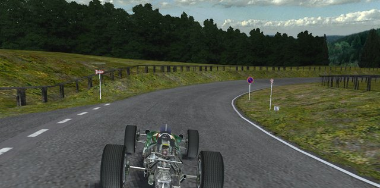

From here to the straight you are always turning: find the rhythm, and steer with the throttle and the road.

- **Right over the hilltop:** lift (perhaps brush the brakes) just *before* the top, or you oversteer over it. Balanced
  throttle, late apex; exit just left of centre.

## 17. Wippermann

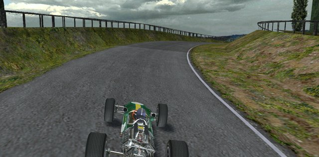

- **Right:** a feel corner: tap the brake and lift about two thirds of the way from the previous left; late apex.
  Line beats power.
- **Left:** brake gently and change down to second at the white line; middle apex; stay inside, then let the bump slide
  you to the middle.
- **Downhill right:** no brakes; steer on the throttle; it oversteers easily, so release it gently.

## 18. Brünnchen

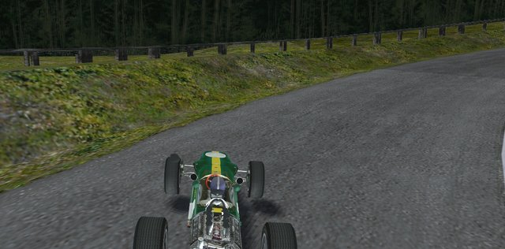

- **Uphill right:** brake gently; hard braking bottoms the car out. Late apex, just before the top.
- **Downhill double left:** ease toward the right without tightening the entry. Brake gently, apex before the middle,
  a little power, then late apex at the second bend.
- **Downhill right:** a gentle brake after the bump, early apex, little power; be straight over the bump after it.
- **Uphill right after the bridge:** brake gently as the road turns uphill and trail-brake to a late apex.
- **Two lefts:** use the second bend as the apex of the first. In the second, stay close to the inside on the steep
  downhill exit.

## 19. Pflanzgarten

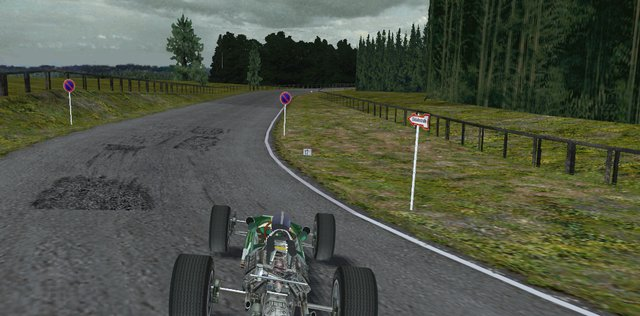

- **Right after the dip:** brake gently from the start of the downhill, all the way in; hard braking bottoms out.
- **Right, then left:** no brake into the right (a change up at the apex); a tap of brake into the left, mid apex.
- **Left over the crest:** the rear takes off. Brake moderately, late apex, and go over the top straight, aiming
  slightly right; light throttle until all four wheels are down.
- **Esses:** a late apex at the first one decides them all. Change up into the third.
- **Right over the bridge:** brake fairly hard as the right bend starts, already pointed right; a little power over the
  crest on the bridge.

## 20. Schwalbenschwanz

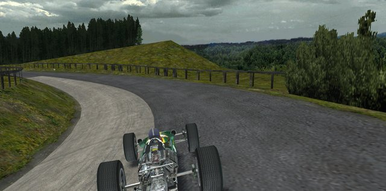

- **Uphill left:** brake hard for a moment, then let the hill slow you; full lock at the crest, apex past the middle.
- **Small Karussell:** brake hard at the dark patch on the climb, and trail-brake onto the narrow banking. Steady
  throttle; a little more as it climbs, but not so much that you slide off.
- **Uphill right:** brake gently; late apex just before the top; a smooth exit matters more than speed.
- **Right onto the straight:** the most important exit on the lap. One arc from the previous corner, change up at the
  crest, a slight power slide, late apex. A lift here gives the car behind its pass.

## 21. Döttinger Höhe

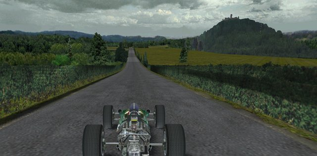

The long straight: the third passing place. Time your tow so the other car can't pass back before the bridge. The car
takes off over the big bump in the middle: ease off, then back to full power with the wheels straight when you land.

## 22. Antoniusbuche

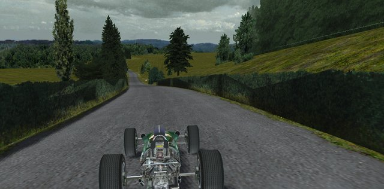

A very fast left under the bridge, where the car goes light. Turn in very gradually at the second tree on the right, with
a small lift: enough power to understeer slightly, which keeps you off the bushes. Hold the steering and revs until you
land, then full power to the right edge.

## 23. Tiergarten

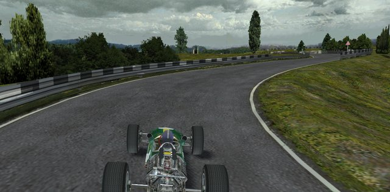

- **Left-right:** from the right, turn in just before the sign on the right with little steering; late apex. Halfway
  through, brake hard for a moment and change down one gear; late apex at the right.
- **Left-right-left:** you lose about 160 km/h. Brake hard where the dark line starts and change down to second,
  staying right. Late apex by the barrier, brake again, mid apex at the right, then the last left past the end of the
  barrier. Lift rather than spin the wheels: a clean exit gives you the tow into Südkehre.
