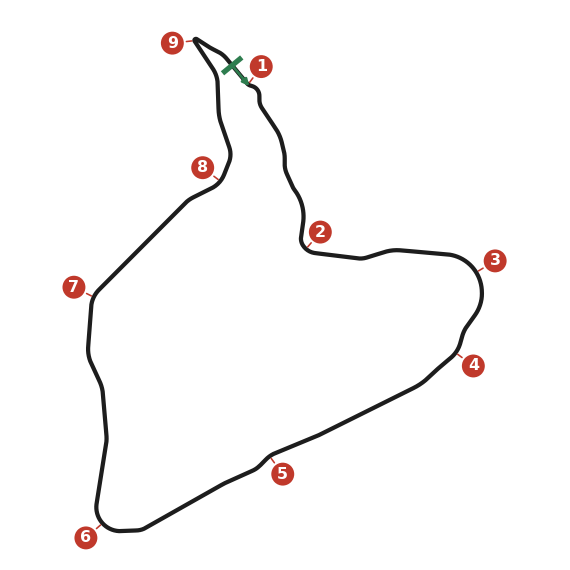
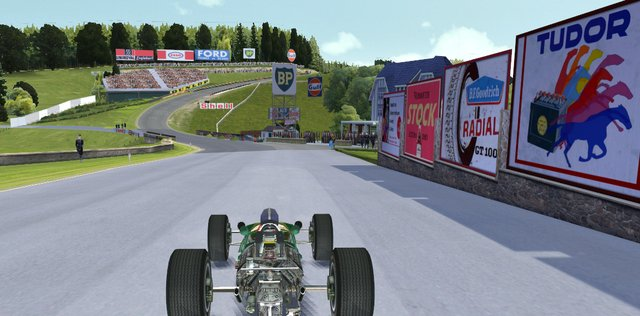
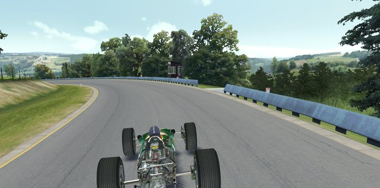
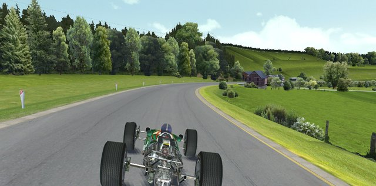
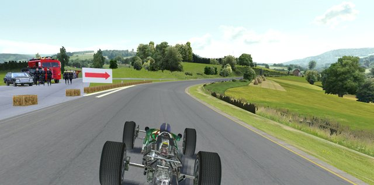
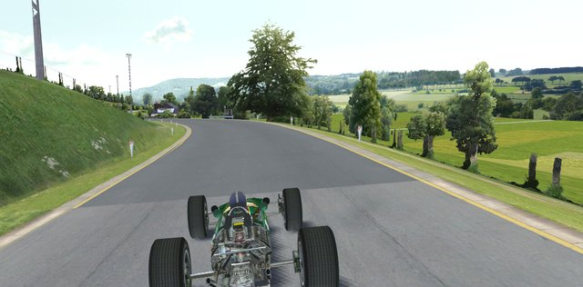
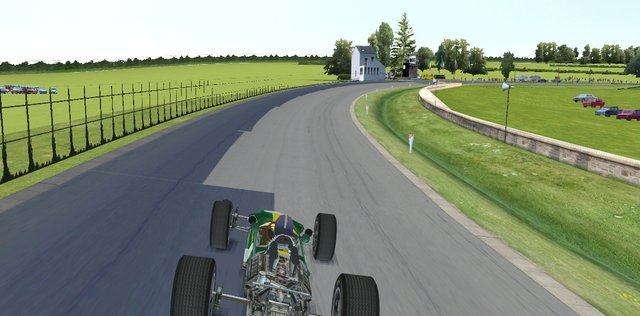
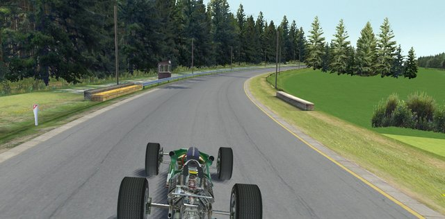
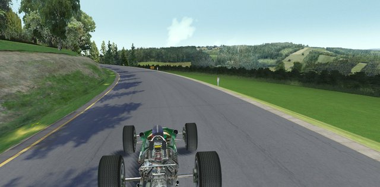
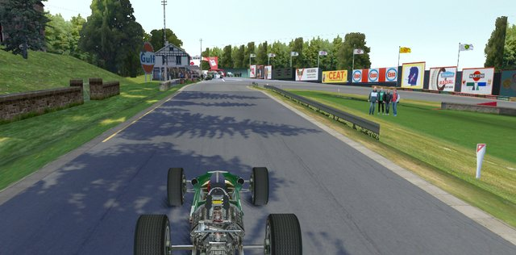

# Spa-Francorchamps

A 14 km lap: about half of it is in top gear and most of it is flat out. You win time on the exits, because nearly
every corner leads onto a long straight. La Source is the only hard braking point; everywhere else you lift or brake
lightly.

## Setup

- **Top speed comes from the exits.** Get the car turning well first (dampers and anti-roll bars), so you can be on the
  power before the exit. Gearing comes after that.
- **A little oversteer.** Understeer is what costs you here: it makes you lift through Burnenville and Masta. Under
  braking oversteer hardly matters, because only La Source brakes hard.
- **Test the setup in Burnenville.** You should get three quarters of the way round before you have to lift. If you
  can't, stiffen the rear bar a little, but keep it softer than the front.
- **Gears:** first gear only out of La Source; most corners are third or higher. Set top gear on the straight into Masta,
  where you should reach the rev limit just before the turn-in. Leave some revs spare for the tow in a race.
- **Diff:** plenty of plates, so the rear wheels don't spin separately in the long corners. A higher coast ramp steadies
  the car into La Source.
- **Brake bias:** as far forward as you can. Move it back one step once the fronts lock at La Source.

## Corners

### 1. Eau Rouge

The trickiest corner on the lap: a fast, blind left-right-left, from the bottom of the hill to the top. Be gentle and
smooth; if you make a mistake, correct it calmly, never with a stab of brake or throttle.

- **Approach:** flat out down past the pits, close to the wall on the left.
- **Brake:** halfway along that wall, a light touch only. Brake hard and the car bottoms out as the road climbs, and you
  lose the grip.
- **Right-hander:** about half throttle, middle apex, right against the barrier. Going over the dirt is better than
  missing the apex.
- **Final left:** briefly full throttle, then ease off for a late apex. Keep some power on all the way through: it
  balances the car. Your left wheels can run on the hard dirt, but stay off the bank.
- **Exit:** full throttle, let the car drift right; the next right bend is flat.

### 2. Les Combes

A fast right kink, then a left-hander that needs real braking. Brake early rather than late: running wide here lets the
car behind through.

- **Kink:** start on the left, late apex, flat, with a small lift halfway to help the nose in.
- **Brake:** gently at first (you're still turning right and the right front locks easily), then harder as you change
  down.
- **Line:** middle apex; turn in on no brake and no throttle and let the engine slow the car.
- **Exit:** feed the power in from three quarters of the way round; run out to the right edge. The left and right
  kinks that follow are flat.

### 3. Burnenville

A long, fast right-hander that tightens. It's all about how long you can keep the power on.

- **Entry:** middle of the road, flat in top gear, under the bridge.
- **Through:** follow the dark rubbered line, just to its right. Past the last houses you have to ease off.
- **On full lock:** whenever the car starts to understeer, lift, then try the power again. Don't drift too far left, or
  you'll be off line for Malmedy.
- Don't try to pass here: wait for Masta.

### 4. Malmedy

A left, then a blind downhill right into a dip. The exit leads onto the longest straight of the lap, so everything is
set up for the second part.

- **Left:** stay a little right of the dark line on the way in. Brake gently just before the second marker board, change
  down one gear, apex just past the middle.
- **Between the two parts:** brake a little more and maybe change down again. Without it the car oversteers down the hill.
- **Right:** turn in just before the crest (the flagpoles on the right help); middle apex, back to full throttle at the
  apex.
- **Down the hill:** keep as straight a line as you can through the last two apexes, and stay on the power even if the
  car slides. Watch the wall on the left at the exit.

### 5. Masta

A very fast left-right flick between the houses, and the best place to pass: use the tow down the straight from Malmedy
and take the inside.

- **Approach:** in top gear, on the right side of the road but not against the edge.
- **No brakes:** where the dark line starts, wait a beat, then half throttle and turn in.
- **Left:** early apex, tight to the bank; a wheel on the dirt is fine. Let the car drift off the apex at about half
  way: earlier and you hit the barrier on the right, later and you scrub off speed.
- **Right:** go straight on at half throttle to set up an early apex, then full throttle, right next to the barrier.
  Run out to the left.

### 6. Stavelot

A long downhill right-hander that tightens. No braking: the engine does it all. Don't race side by side through here.

- **Entry:** in top gear from just left of centre, following the dark line. Ease off where it darkens for the second
  time, and move toward the right side of the road.
- **Slowing:** lift a little more rather than braking, because the brakes unsettle the rear. Change down at the hay bales
  on the left, and once more near the wall on the right.
- **Exit:** from halfway along the wall, back to full throttle. A little power slide is fine. Let the car run out to the
  left and get to top gear as soon as you can.

### 7. La Carrière

Two right-handers after a left kink. The second one leads onto the long straight to Blanchimont, so its exit matters
most.

- **Kink:** flat, late apex; that puts you on the left for the first right.
- **First right:** turn in just before the tree on the right with a small lift; middle apex. Dirt at the apex is fine,
  but running wide puts you up the bank.
- **Second right:** where the dark line starts, brake moderately and change down two gears; apex just after the middle,
  then back on the power. Correct the small slide on the exit.

### 8. Blanchimont

A right kink and two left-handers.

- **Kink:** flat, late apex, which leaves you on the right.
- **First left:** brake moderately where the dark line fades again; change down two gears. Early apex, but not too
  early, or you run onto the bank at the exit.
- **Between them:** let the car drift out a little, but not too far right. Change up just before the second left.
- **Second left:** middle apex on full power; dirt is better than running wide, so the right bend after it stays flat.

### 9. La Source

The hairpin before the line, and the one hard stop of the lap. Don't spoil a long lap by braking too late into the hay
bales.

- **Left before it:** nearly flat; small lift, apex just after the middle, drift out right past the barrier.
- **Brake:** move smoothly to the left side of the road. Brake as hard as you can, in a straight line, just before the
  small lone tree on the left. Change down to second while braking; take first only as you turn in, or the rears lock.
- **Turn-in:** just past the end of the barrier on the right; mid to late apex with a trace of throttle.
- **Exit:** full throttle by the end of the kerb on the right, then let the car move left on the run down to Eau Rouge.
