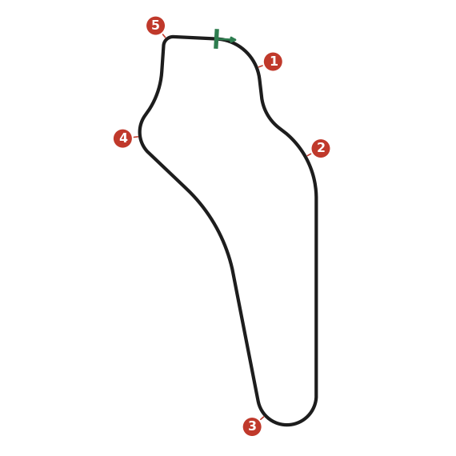
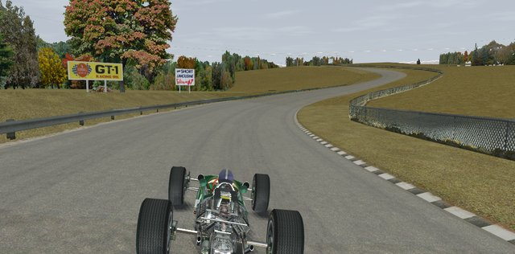
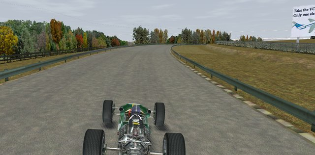
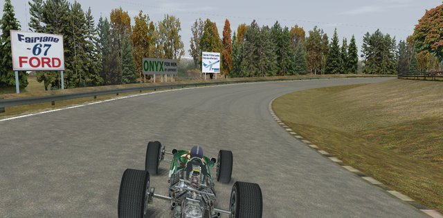
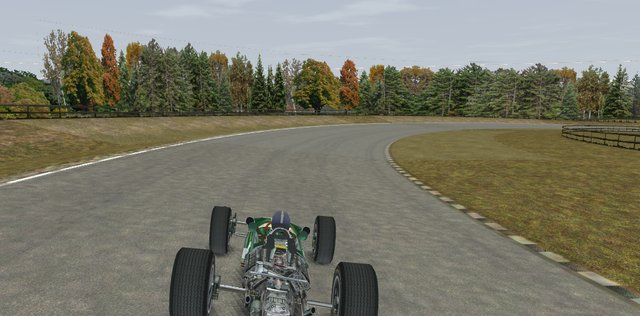
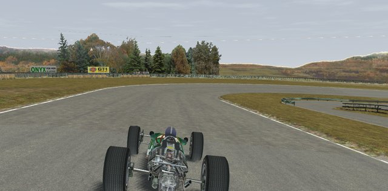

# Watkins Glen

The shortest lap of the season, just over a minute, so you're in traffic most of the race. Passing safely and smooth,
straight-line braking win here. The road has a strong crown: arrive at a braking zone sideways and you leave it more
sideways.

## Setup

- **Do laps before setup changes.** Brake in a straight line for every major corner. If the rear lets go under braking,
  check your line in the replay before you touch the setup.
- **Balance:** neutral, even a little understeer. Oversteer costs you at the Loop and the Big Bend; trail-braking gives
  you the turn-in you need.
- **Bars medium to stiff** for the fast sweepers; dampers a little softer. If you still understeer mid-corner, soften
  the front bar.
- **Gears:** set top gear on the front straight. Fourth should take you almost through the Esses, with the change to
  fifth midway through the last right. Third should last all the way through the Loop. Second is for traction out of
  the 90.
- **Brake bias:** a few steps back from where the fronts lock, so trail-braking still turns the car.
- **Start:** turn 1 is just past the line, and you'll be two abreast into the Esses. Don't try to pass into the Loop on
  cold tyres.

## Corners

### 1. Turn One

A fast right-hander just after the line. Its exit sets up the Esses, and the Esses set your speed down the front
straight.

- **Entry:** from the left, no brakes; a small lift helps the car turn in, just before the line.
- **Through:** change up as you reach the hay bales on the left, then hold a steady speed.
- **Exit on the right**, with no sliding. Go slower if you have to. Full power again from the sign on the left.

### 2. The Esses

An uphill left-right sweep with no braking. Be smooth: steering movement scrubs off speed.

- **Left:** from the right, turn in where the dark line darkens with a small lift. Run close to the kerb, but never on
  it: it throws the car into a spin.
- **Crest:** the rear goes light as the hill flattens. Just before it, straighten the wheel (even a little right) and be
  back on full power. That plants the rear and points you across to the right.
- **Right:** full power along the barrier, without getting too close. Change up midway, and finish on the left just after
  the barrier ends.

### 3. The Loop

A long, slow left-hander over a crest at the end of the straight. It begs you to push too hard. Brake a little early when
you're defending: the cars that brake late often run wide.

- **Brake:** from the left, at top speed. Pass the sign on the left, wait a beat, brake hard and change down two gears.
  Stay off the crown.
- **Crest:** ease the brakes as you crest. The rear goes light; let the brakes, not the wheel, start the car turning.
- **Turn-in:** release the brakes progressively and be ready to catch the car with a little opposite lock. A touch of
  power keeps the rear planted, and a tap of the brakes cures understeer.
- **Exit:** from the access road on the right, add power smoothly while staying on the kerb; a light drift is ideal.
  Your exit speed counts all the way to the Big Bend.

### 4. Big Bend

A fast left-hander, then hard braking for a right-hander.

- **Left:** flat, on the left side, where the crown helps you round. You need to be fully under control at its exit,
  because braking starts right away.
- **Brake:** from the left, hard, as you pass the end of the barrier on the right; change down two gears in a straight
  line.
- **Turn-in:** follow the dark line, trailing off the brakes to turn the car. A little power near the apex steadies the
  rear.
- **Exit:** power back on from two thirds of the way round; run out to the left.

### 5. The 90

The slow right-hander onto the pit straight, straight after a fast left.

- **Left before it:** move across early, so the crown helps you round. Change up halfway round.
- **Brake:** hard, right as the left ends. Keep to the left, off the crown, or the car spins to the left. Change down to
  second.
- **Turn-in:** just before the pit-lane barrier on the right. The banking turns the car in faster than you expect. A beat
  too early and you ride the kerb; a beat too late and you understeer off. The apex is just past where the kerb begins.
- **Exit:** unwind and feed in the power. There's room on the left if you slide.
