# Zandvoort

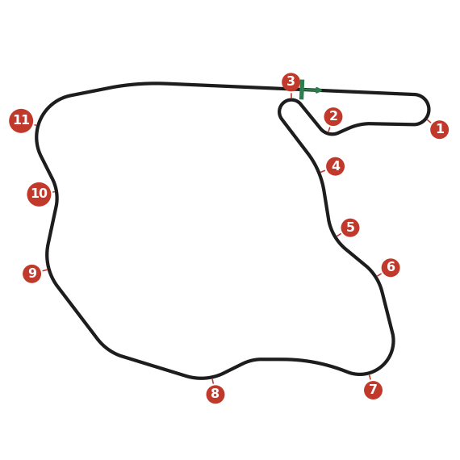

Through the dunes, with many blind corners and crests, each corner leading straight into the next. One mistake costs
you half a lap of rhythm. Passing is hard: the end of the straight (Tarzan) is the best place, the hairpin the second.
Often the best you can do is pressure the car ahead until it runs wide.

## Setup

- **Quick, smooth changes of direction** without braking. Not much oversteer: a spin here leaves you out in the dunes.
- **Gears:** most of the lap is in third and fourth; top gear is for the straight, with the limit just before Tarzan.
  Space third and fourth so you never change up just before a corner only to change down again.
- **Diff:** both rears must drive out of the corners. Start at 3 plates and adjust by one; ramps as high as you can
  control.
- **Springs and bars:** medium dampers, stiffer anti-roll bars.
- **Brake bias forward:** Tarzan is the only hard stop, and it's straight.
- **Consistency:** a steady pace all race beats a few perfect laps.

## Corners

### 1. Tarzan

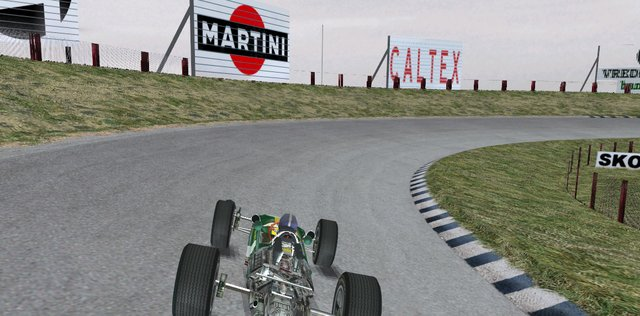

The hairpin at the end of the straight, and the only big braking zone. Don't follow a car closely into it: you don't
know where it will brake.

- **Brake:** from the left, though not right on the edge (the grass is close). Brake as hard as you can just after the
  hay bales at the end of the pits, in a dead straight line.
- **Gears:** down to second, reached just as you turn in. First only spins the wheels.
- **Turn-in:** trail-brake to help the car turn; apex a quarter of the way round, and balance the car on the throttle.
  The camber pulls you onto the kerb; use the throttle to keep off it.
- **Exit:** squeeze, don't stamp: too much power too early puts you in the fence. Aim for the left side of the road.

### 2. Gerlach

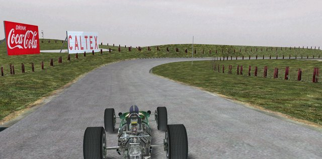

A drawn-out chicane: a fast left over a small brow, then a slower right. Enter too fast and the crest and camber leave
no room to slow down.

- **Left:** in third, from the right of the road for a flatter entry. No brakes: ease off at the apex, at the top of the
  brow, and change down to second.
- **Between:** a light brake on the short straight (the dark patch). Brake hard and the rear lets go.
- **Right:** trail off the brakes as you turn in, with a little throttle to balance the rear.
- **Exit:** a small drift to the left, then move right as soon as you can.

### 3. Hugenholtz

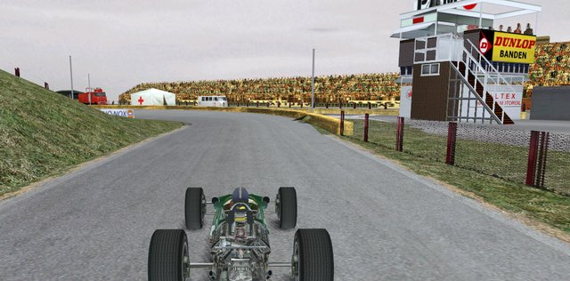

The slowest corner, a hairpin. A poor exit spoils the next three corners, so the exit comes first.

- **Entry:** from the right. Brake gently just before the darker patch (hard braking only makes the car go straight
  on), change down to first and turn in.
- **Through:** off the brakes, on the throttle; the banking pushes you onto the kerb, so use the power to hold the car off
  it. Leave the apex at about three quarters of the way round. If you leave it earlier, ease off: an early exit puts you
  on the grass.
- **Exit:** right of centre, not on the far right, because the next corner is a right-hander. Feed the power in
  firmly in first, and lift if the wheels spin.

### 4. Hunzerug

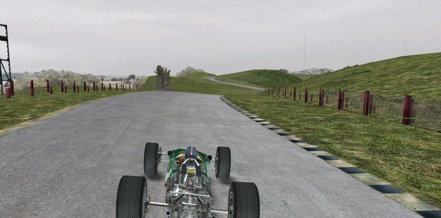

A blind right over a hilltop, and the start of the flowing section. From here to the straight you turn almost all the
time and hardly brake.

- **Approach:** in third, near the middle of the road, not too far right.
- **At the crest:** ease off to keep the grip; most of the turning happens on the top. Back on the power once you're
  over it, and change up.
- **Exit:** hold the kerb at full throttle; don't drift too far left, because Zijn Veld comes straight away.

### 5. Zijn Veld

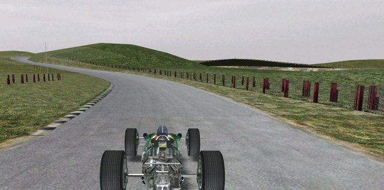

A fast left-hander, in fourth all the way.

- **Entry:** from the right; just before the dark line, lift slightly and turn in. Late apex, about half throttle.
- **Exit:** the road goes from downhill to uphill and the camber changes; build to full power and let the car slide
  to the right. If the rear goes, lift and catch it before the next corner.

### 6. Jan de Wyker

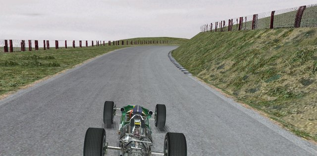

A blind right with a steep crest just as you exit. One of the hardest corners.

- **Entry:** cross to the right, but not too early. A slight brake and one gear down just before the kerb begins.
- **Through:** middle apex, held on a steady, slightly cautious throttle. Too much power, or a nervous foot, and the
  car flies off to the left at the exit.
- **Crest:** come off the kerb as you see the top of the hill. Be a little left of centre at the crest, with the car
  pointing dead straight; still turning, it spins.

### 7. Scheivlak

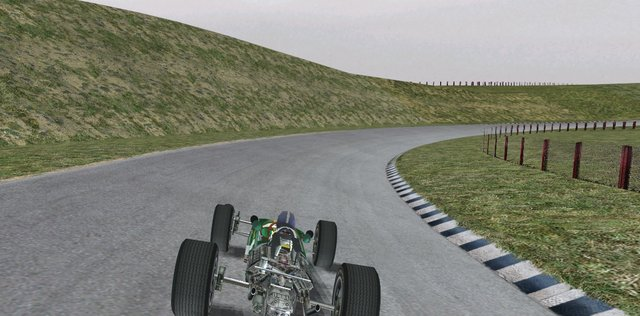

A long, slower right-hander just over the crest. Don't rush it: it punishes with understeer.

- **Entry:** from the left. Brake softly just after the dark line starts and change down one gear.
- **Through:** reach the kerb early and stay on it. Closer to the kerb: more throttle. Understeer: a small lift.
- **Exit:** as the road starts to climb, build the power and drift left. Be against the left side over the small crest
  that follows, which sets you up for Hondenvlak.

### 8. Hondenvlak

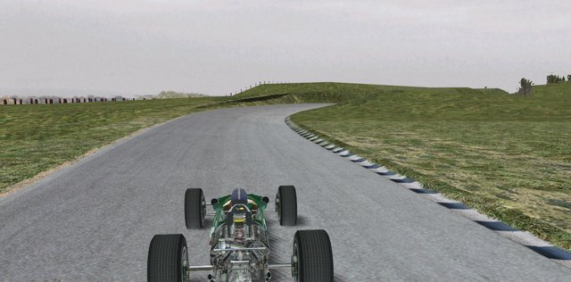

A left and a right close together; the second depends on your exit from the first.

- **Left:** in fourth, no brakes. Where the dark line starts, keep the power on, then half throttle and turn in.
  Late apex: an early one throws you off at the exit.
- **Between:** don't drift too far right, or you hit the kerb into the right-hander.
- **Right:** a brief brake (or just the engine) and down to third. Middle apex; both early and late send you off.
  Power from half way, and drift left onto the straight.

### 9. Tunnel Oost

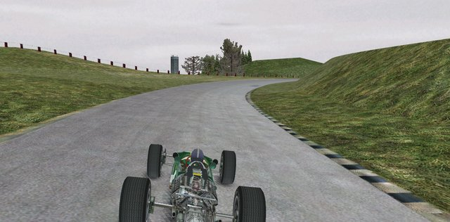

A right-hander by the bridge, taken with a lift.

- **Entry:** in fourth, from the left; follow the dark line. Keep the power on for a moment as it darkens, then half
  throttle through.
- **Exit:** back to full power past the end of the bridge on the left. Expect a drift and a touch of opposite lock;
  keep off the grass.

### 10. Panorama

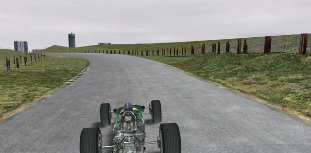

A right, then a faster left.

- **Right:** from the left. A short stab of brakes and down to third as you reach the dark line, turning in at the
  same time. Apex in the second half: an early apex or a ride on the kerb spoils the left.
- **Left:** change up before it. A slight brake and down to third at the bushes on the right; late apex, full throttle
  by the apex, and exit toward the middle.

### 11. Pulleveld

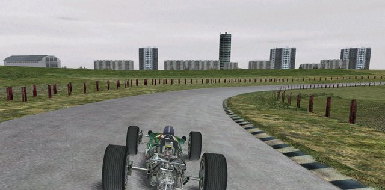

The last right-hander onto the straight. An opening corner: the exit is everything.

- **Entry:** at the top of the little hill, between the spectators on the right and the tower on the left, change down
  to second and brake for a split second.
- **Through:** reach the kerb early and stay there; add power as the corner opens. Change up to third, but not too
  early; you should be in third by the flagpole on the right, at full power.
- **Exit:** not too far left: the road keeps turning right to the kink on the straight. A hump on the exit unsettles
  the car.
